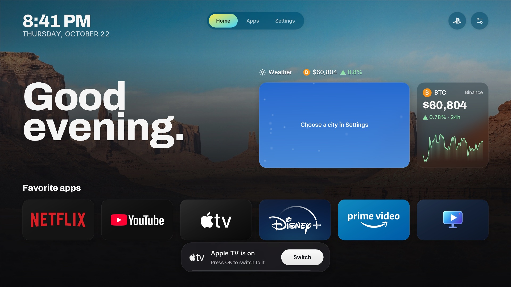

# Sera: LG webOS TV Launcher

**A fast, remote-first launcher and home screen for LG webOS TVs, with an Apple TV feel.**

Sera replaces the cluttered LG Home with one calm screen: your favorite apps, live wallpapers, widgets, your Jellyfin and Plex libraries, your PC games over Moonlight and your Home Assistant devices. It's a native Rust app drawn with OpenGL ES, so it stays smooth on TV hardware. Free and open source (MIT).

> Sera is a fork of **[Luma](https://github.com/funnymataleao/luma-webos-launcher)** by [Denis Efremov](https://denisefremov.com), renamed and developed independently. It builds on everything Luma does, adds new features and optimizes parts of it, such as hardware video playback, HDMI input detection and how settings are stored. It is not affiliated with or endorsed by the Luma project. See [Credits](#credits).


## What's new in Sera

Everything Luma does, plus new features and optimizations:

- **Switch to a device the moment it turns on**: when a console, PC or streaming box on an HDMI input switches on, Sera shows its name and OK switches to it straight away. Sera listens to the TV's HDMI reports instead of polling them, and a PC is offered as soon as it powers the cable, several seconds before its first picture. Handy for devices without HDMI-CEC.
- **Animated wallpapers** generated live on the GPU: aurora, waves, plasma, lava lamp, silk, bokeh and Christmas snowfall.
- **Air quality widget**: European or US AQI, pollutants, a 24-hour outlook and pollen, from Open-Meteo.
- **Smoother video wallpapers**: hardware playback now runs at the clip's full frame rate instead of dropping to about 15 fps.
- **HDMI signal at a glance**: a green dot on inputs that are sending a picture, a dimmed icon for a sleeping console or PC, and new Nintendo Switch and Windows input icons.
- **Italian** as a sixth interface language.
- **Plex QR pairing that works**: scanning the QR code now links your account, not only the typed code.
- **Reliable at the wall switch**: settings survive power cuts, a damaged settings file no longer stops the launcher, and diagnostic logs can't fill the TV's storage.
- **Opens on a cold boot**: with root, Sera stays in front even when the TV restores the last HDMI input a few seconds after starting.
- **Moving from Luma**: on its first start Sera brings over Luma's settings, weather location, Home Assistant sign-in and custom app artwork.



## Features

- **Home**: favorite apps, "stacks" of content from Jellyfin, Plex and Moonlight, video wallpapers (Apple and Amazon aerials, played in hardware), a weather-aware headline, clock and date. Frosted-glass look with adjustable accent colors, fonts and UI resolution (Auto / 4K / 1440p / 1080p).
- **Widgets**: weather with hourly and 10-day forecasts, air quality, crypto prices, HDMI input preview and Home Assistant status, in four sizes on a grid.
- **Movies, series and music** (Jellyfin, Plex): sign in with a code or a QR code on your phone, detail pages with cast, seasons and episodes, a companion player with audio and subtitle tracks, and progress synced back to your server. Plex support is less tested than Jellyfin.
- **Games** (Moonlight): your Steam library from a PC running Sunshine or Apollo, with Steam artwork. **Play** opens the stream in Moonlight.
- **Smart Home** (Home Assistant): pair with a QR code, then use status chips, scenes, live cameras and device tiles from the remote.
- **Remote first**: built for the D-pad (Back always steps one level out), and the Magic Remote pointer works everywhere.
- **Languages**: English, German, Spanish, Brazilian Portuguese, Simplified Chinese and Italian.

<table>
  <tr>
    <td width="50%"></td>
    <td width="50%"></td>
  </tr>
  <tr>
    <td width="50%"></td>
    <td width="50%"></td>
  </tr>
</table>

## Install

**Homebrew Channel**: add this repository in Homebrew Channel › Settings › Repositories, then install **Sera** and **Sera Player** (needed for Jellyfin and Plex video).

```text
https://github.com/minux84/sera/releases/latest/download/repo.json
```

**Manual**: download `it.bytebuilder.sera_3.0.0_arm.ipk` and `it.bytebuilder.sera.player_0.0.11_all.ipk` from [Releases](../../releases/latest) and install them with [webOS Dev Manager](https://github.com/webosbrew/dev-manager-desktop) or `ares-install`.

For games, install Moonlight for webOS and pair it with your PC first.

**Coming from Luma?** Install Sera alongside it and open Sera once: your settings come over automatically. If Luma opens when the TV turns on, switch that off in Luma first, then turn it on in Sera.

## Root features

Sera runs as a normal app. On a rooted TV (Homebrew Channel, elevated), **Settings › System › Root features** adds:

- Open Sera when the TV turns on, and turn LG Home "Auto Launch" off.
- Leave a Moonlight stream by pressing Start + Select twice.
- A more reliable app and HDMI input list with app icons, and HDMI signal detection.

Without root this section is hidden and Sera never changes system files.

## Build from source

Requirements: Rust 1.93 (pinned in `rust-toolchain.toml`), Node 22+, pnpm 10, SDL2 for the desktop preview.

```sh
pnpm install --frozen-lockfile
pnpm sdk                    # webOS NDK and runtime into .build/
pnpm run package            # → dist/*.ipk, sha256sums, repo.json
pnpm assets && pnpm dev     # desktop preview with sample data
pnpm deploy:root            # build and install on a rooted TV over SSH (settings in .env.tv)
```

Tests: `pnpm test`. Lint: `pnpm check`. More in [development.md](development.md).

## Privacy

No telemetry, accounts, ads or built-in API keys. Settings and sign-ins stay in a local file on the TV, and weather uses the location you choose, never IP geolocation.

## Credits

Sera is a fork of **[Luma](https://github.com/funnymataleao/luma-webos-launcher)**, designed and built by [Denis Efremov](https://denisefremov.com) ([@funnymataleao](https://github.com/funnymataleao)). Almost everything here, from the interface and the renderer to the media, widget and smart-home features, comes from Luma. Luma itself started from **[ecklf/lg-luma](https://github.com/ecklf/lg-luma)** by ecklf and contributors.

If you like this launcher, please consider supporting the original author: [Ko-fi](https://ko-fi.com/dennis_oizo), [Buy Me a Coffee](https://buymeacoffee.com/denisefremov) or [GitHub Sponsors](https://github.com/sponsors/funnymataleao).

Thanks also to [webOS Homebrew](https://www.webosbrew.org/), [Moonlight](https://moonlight-stream.org/), [Sunshine](https://github.com/LizardByte/Sunshine), [Apollo](https://github.com/ClassicOldSong/Apollo), [Jellyfin](https://jellyfin.org/) and [Home Assistant](https://www.home-assistant.io/). Fonts are under the SIL Open Font License; wallpapers, icons and their licenses are listed in [assets.md](assets.md). Brand logos belong to their owners, and Sera is not affiliated with LG, Apple, Amazon, Valve, Jellyfin, Plex or Home Assistant.

## License

[MIT](license). Copyright © 2026 Luma contributors and © 2026 Carmine Savino (Sera changes).
